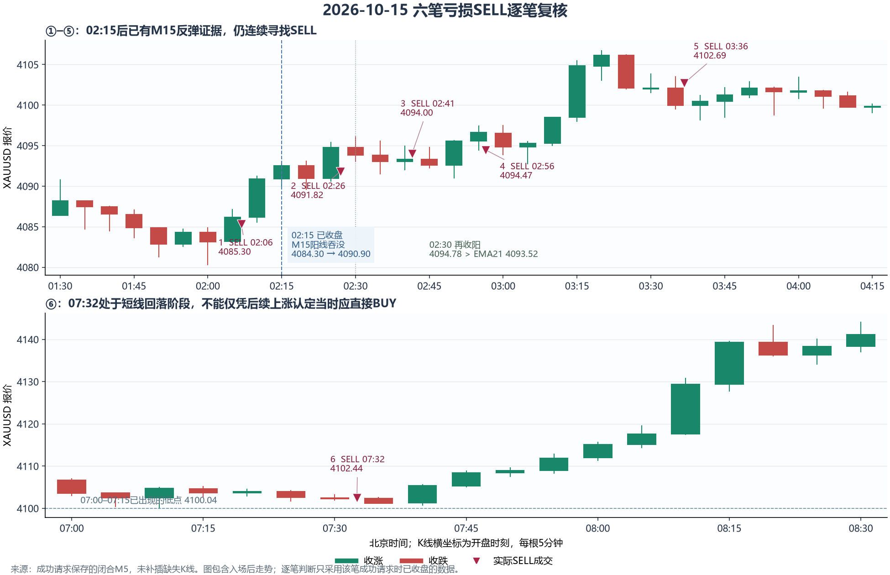

# 10月15日六笔亏损SELL：当时是否应做BUY

复核日期2026-10-15，全部时间为北京时间。沿用上一份分时胜率报告的日志截止11:15:26，分析对象是02:06、02:26、02:41、02:56、03:36、07:32六笔**亏损SELL**，净亏13.37美元。前五笔连续亏损；其后04:11有一笔盈利SELL，故这里不是连续六笔，也不是当日全部八笔的样本。

**判断：02:26、02:41、02:56三笔，开仓前已经存在值得重视的短线做多证据，继续以薄弱信号做空缺乏说服力。BUY值得优先评估；这不等于六个原成交点都能组成合规、盈利的BUY方案。** 03:36同样不能忽略反弹结构，但已在较高位置，07:32则处于局部回落。02:06尚未出现02:15才收盘的M15阳线，不能把这根后来的阳线用于其入场判断。

本轮仅记录分析，不修改策略、提示词、护盘、实际.env或模型上限，不连接MT5、请求真实AI、发送通知或启动交易。

图中包含入场后走势，便于对照用户看到的K线；各笔判断只采用该笔成功请求时已经闭合的K线。横坐标为K线开盘时刻，M5需再经过5分钟才闭合。两面板覆盖的时间不同，不能当作连续等长行情。未插值或补造K线，重叠快照的OHLC没有冲突。

## 六笔逐笔判断

| 北京时间 / ticket | 开仓时已闭合的证据 | AI实际选择 | 本轮判断 |
| --- | --- | --- | --- |
| 02:06 / 610023754 | 最后M15为01:45–02:00阴线，收4084.30；02:00–02:05的M5探4080.34、收4083.15，留下2.81下影。此时02:00–02:15的M15尚未闭合。 | 用M15仅低于前低0.16的破位，以及M5新低做SELL。 | 做空延续确认薄弱，M5已有拒跌；更宜等新低被有效接受或反弹失败。尚不足以用后来的M15吞没宣布此刻BUY已经确认。 |
| 02:26 / 610064191 | 02:15已收盘的M15从4084.30涨至4090.90，实体与全幅覆盖前一根；随后M5继续上推，再回踩4089.60。 | 最新M5高4093.08，只超过先前高4093.02 **0.06**，AI据此选择假突破SELL，并把M15阳线吞没列为轻微反证。 | 这轮更应重视反弹后的回踩及BUY假设，而不是用0.06的刺破认定反弹结束；原价立即BUY仍需完整保护位、目标空间和方向许可。 |
| 02:41 / 610101678 | 02:15–02:30的M15继续从4090.90收至4094.78，已高于当时M15 EMA21约4093.52；较02:00M15的低点也明显抬高。 | 最新M5收4093.03，仅低于前低4093.09 **0.06**，配合上影再SELL。 | 反弹已有延续和均线收复证据；更值得评估回踩做多，或至少暂停逆着短线反弹试空。单个小破位未充分证明反弹结束。 |
| 02:56 / 610126597 | M15出现4096.07回落，确有局部卖压；但02:50–02:55的M5从4092.56收至4095.56，阳线吞没前一阴线，近收最高。 | 以02:30–02:45的M15假突破做SELL，把最新M5阳线吞没仅作轻微观察。 | 有较早的空头信号，也有更新的多头回收。当前小区间并未证实向下脱离，更宜等待最新回收成功/失败；不能只沿用较早卖出叙事。 |
| 03:36 / 610213417 | 最新闭合M15从4098.47收至4102.12，并突破此前高4098.52；近期M15低点整体抬高。但M5已由4106.70回落，最新实体仅0.11。 | 将M15上破记作轻微反证，用最新M5上影及前一根回落继续SELL。 | 反弹结构不能忽略，不过此处BUY也面临4106.70阻力，宜等回踩稳定/再确认。该SELL曾出现采样MFE4.29，不能把最终-0.11简单解释为全程方向错误。 |
| 07:32 / 610446306 | 06:45后的M5/M15正在回落；07:15–07:30的M15收4102.61，07:25–07:30的M5破前低。07:00–07:15的M15低4100.04、收4104.70，低位拒跌仍未被有效跌穿。 | 用多根K线扫高回收与M5破前低做SELL，目标4092.41，越过4100.04。 | 当时做空有局部依据，做多确认尚不充分；但SELL很快面对刚出现过拒跌的4100区域。应评估该支撑的接受/拒绝及做空空间，不能凭07:40后的上涨直接判定07:32原价BUY最优。 |

07:32这笔实际SELL成交4102.44、原SL4106.01，初始风险3.57；到已知4100.04低点只有2.40，即约0.67R。原TP4092.41给出的计划RR约2.81，需要穿越该支撑。**计划TP的RR合格不等于到首个反向障碍也有同样空间。** 这只是风险诊断，不能擅自把每一个前低都升级为必须满足1.5R的硬门，也不能将后来行情加入原目标论证。

02:06也有当时可见的即时反证：AI-2新Bid为4085.20，已经回到所称“跌破”的4084.46上方。它不等同一根新的闭合多头确认，但削弱了“下破正被市场接受”的说法。原方案的文字失效条件要求M15站回更高位置，硬风控仍通过；不能将这个诊断伪称为现行执行代码本应拒绝却漏检的错误。

## 为什么AI从未选BUY

六笔成功AI-1输入均包含：

- `h1_trend=bear`，`m15_trend=bear`。
- BUY的`opportunity_blockers`明确为“自主分析仍要求H1同向”“BUY 与H1不同向”。
- `opportunities`只有一个SELL候选，`computed_evidence.candidate_actions=["sell"]`。

所以AI-1实际是在**SELL和观望**之间选择，BUY没有进入可选池。BUY原始K线并非完全看不到，但没有合法BUY候选和对应方向的完整计算证据，模型不能越过Python方向门自行开BUY。

代码中的方向标签不是最近几根K线涨跌：`xauusd_fib_volume_pa_trader.py:695`的`trend_from_ema`只比较最后闭合收盘与EMA50，H1与M15均用这个函数。它不要求近期高低点继续下降，也不使用EMA斜率。因此短线持续反弹、甚至已站上M15 EMA21，与H1/M15仍显示bear可以同时成立。保存的H1仅8根，不能从这8根精确重建运行时更长历史计算的EMA50数值；本轮依据实际发送标签与代码判定。

实际已闭合的H1收盘也从00:00小时的4083.49、01:00的4084.30，依次到02:00的4096.64、03:00的4101.62、04:00的4105.17，06:00的4106.68。各根只能在其小时结束后用于相应后续决策；不能把这条事后整理的序列整体提前放进02:06的输入。

| 实际开仓时间 | 本地BUY粗筛分 | 本地SELL粗筛分 | AI-1质量分 | BUY进入候选池 |
| --- | ---: | ---: | ---: | --- |
| 02:06 | 60 | 61 | SELL 80 | 否，H1反向 |
| 02:26 | 65 | 53 | SELL 80 | 否，H1反向 |
| 02:41 | 58 | 48 | SELL 80 | 否，H1反向 |
| 02:56 | 68 | 40 | SELL 80 | 否，H1反向 |
| 03:36 | 68 | 43 | SELL 80 | 否，H1反向 |
| 07:32 | 40 | 68 | SELL 80 | 否，H1反向 |

四轮BUY粗筛分更高，说明输入并非没有反弹线索；粗筛分仍不是BUY质量分、概率或可执行资格。不能恢复之前已修好的“比较买卖粗筛分决定下单方向”错误显示或交易逻辑。

## AI-1与AI-2各自暴露的问题

02:26、02:41、02:56、03:36的AI-1确实识别了阳线吞没、站回EMA21或M15上破，但均只放在轻微观察，五项评级全部adequate，最终都是80。02:26与02:41的0.06薄弱触发也只作观察。**本段的主要问题是交易判断对反弹持续性的重视不足、局部形态被重复用作续跌依据，并非无JSON、引用契约失败或AI根本没收到K线。** 不能因为这次亏损就把所有反向阳线一律判为重大扣分；此前契约允许真实的轻微观察仍是必要兼容，不应改回机械拒绝。

AI-2六次均APPROVE；它负责核对原方案事实、SL/TP与最新报价硬限制，没有承担“同时构造BUY并比较哪边更优”的职责。六次AI-2有新Bid/Ask，最后闭合M5/M15时间与对应成功AI-1请求相同，重叠OHLC一致，期间没有跨到新的M5收盘边界。缩短行情窗口/删除派生字段导致字典整体不等，不代表K线被换掉。不能再把这些订单归因为AI-2沿用两分钟前价格或超时下单。

## BUY方向正确也需要入场方案

按每笔AI-2最新Ask，单独诊断“覆盖最近三根M5低点+原M15缓冲”这一项，BUY最小距离依次约为6.19、7.69、4.78、5.02、2.46、1.74美元，均未超过8。这只是一项局部下界：未加入完整反弹失效结构、生成止损下限、首障碍/目标、实时执行净距等检查，**不构成六个可执行BUY计划**。

例如02:26如果只保护最近三根M5，至少需要约7.69；如果该BUY思路必须保护02:00M15扫低4080.34，原缓冲后SL应在4079.34或更低，而Ask4092.26到该处已达12.92，超过SL8。此时应等更合适的回踩或放弃该具体计划，不能为了开BUY把保护位硬裁近。

本轮没有在六个亏损点反手回放；不能沿用SELL的SL/TP镜像、不计点差和路径后宣称BUY六胜，不能用这六个选出的亏单证明反向策略有收益。03:36曾有可观有利波动、07:32仍有局部下跌，也说明入场时点、目标和护盘会改变结果。

## 后续设计取舍（未实施）

优先需要纠正的是**当短线反弹持续时，不能因H1允许SELL就持续寻找微小卖点**。向AI补充已结算的同向失败、原失效区域与后续收盘高低点变化，有助于它区分新机会与同一反弹段的重复试单；判断应基于真实变化，不按亏损次数强制反手，不靠提高80到85掩盖所有样本。

若后续明确要求AI参与这类反弹BUY，则必须另行设计并验证有独立失效结构与风险约束的短线方向许可，而不是只在提示词写“可做BUY”、直接删H1门，或修改某几个时段/买卖阈值挑选这六个赢家。当前已有的H1硬限制继续保留；“先让AI少在反弹里试空”与“开放逆H1的BUY”是不同的策略改动，前者也不能保证后者收益。

本轮只读结论：用户对中间几笔反弹方向的观察有当时数据支持；不能认定六笔都应在原价直接买。现有架构既限制了BUY通道，也没有让AI对多个连续反弹证据给予足够权重，导致多次选择SELL。

## 证据与验证

输入为`server_deploy/xau_fib_pa_logs/ai_decisions/2026-10-15.jsonl`，SHA256：`06f6cae3312cb486359e296a12a45c4e62d76225b41323339990ea4afb8eb275`。六笔ticket与历史结算沿用已提交的`2026-10-15-confirmed-gold-trades.csv`，并逐笔匹配各自执行`decision_id`。

| ticket | decision_id | 成功AI-1输入行 | AI-2输入行 |
| --- | --- | ---: | ---: |
| 610023754 | 1792011900-13 | 96 | 98 |
| 610064191 | 1792013100-17 | 112 | 114 |
| 610101678 | 1792014000-19 | 121 | 123 |
| 610126597 | 1792014900-22 | 131 | 133 |
| 610213417 | 1792017300-30 | 158 | 160 |
| 610446306 | 1792031400-57 | 246 | 248 |

07:32主路超时，采用07:32:06备用请求的输入；07:30:01初次输入不当作成功回复的证据快照。原始bar时间按服务器偏移3小时转换UTC后再转北京时间，等价于原数值作UTC显示后加5小时；本地日志时间不再平移。

离线断言核对：六笔净亏合计13.37；H1均bear；BUY均因H1被阻止；每次仅一个SELL候选；AI-1/AI-2最后闭合来源时刻及重叠OHLC一致；输入所有K线结束时间均不晚于该请求观察时刻；93次AI-1输入合并203根唯一M5，重叠OHLC冲突0；生成图后原始JSONL哈希不变。诊断CSV为`2026-10-15-six-sell-entry-diagnostics.csv`；图为同名前缀`review.png`。没有修改生产代码，不运行生产回归或交易进程。
