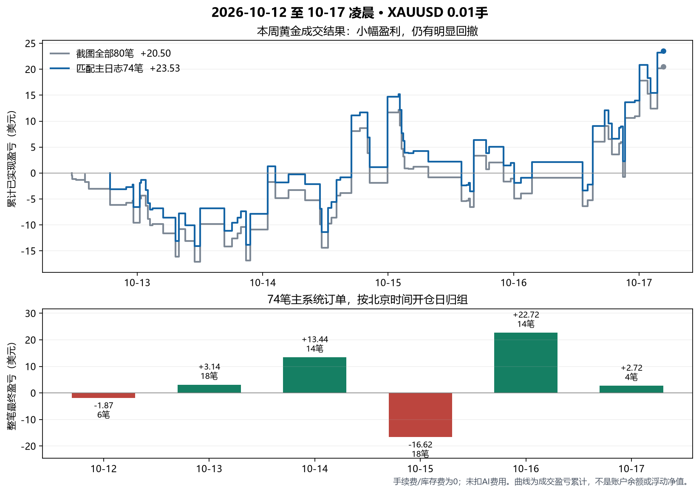

# 2026年10月12日至17日凌晨黄金周复盘

本周黄金成交实现小幅盈利，但优势仍薄，收益依赖少数较大盈利单。下一步适合保留双向自主入场与离散锁盈，先稳定执行、收集同版本样本，再评估入场和减亏；这份数据不足以支持加手数、统一禁做BUY/SELL或把盈利保护继续整体收紧。

本报告采用用户最后更正的 **XAUUSD专用品种历史长截图**，忽略上一张全部品种截图。主日志冻结至北京时间 **2026-10-17 04:52:16.842**。没有连接MT5、请求交易AI、发送通知、修改实际.env/策略/运行状态或启动交易进程。

## 1. 完整结果与来源

| 统计范围 | 笔数 | 盈利 / 亏损 / 持平 | 胜率 | 成交净盈亏 |
|---|---:|---|---:|---:|
| 更正截图全部黄金 | 80 | 40 / 39 / 1 | 50.0% | +$20.50 |
| 可匹配三AI主系统日志 | 74 | 39 / 34 / 1 | 52.7% | +$23.53 |
| 本轮主日志之外的截图记录 | 6 | 1 / 5 / 0 | 16.7% | -$3.03 |

74笔按方向、0.01手、真实成交开仓价与持仓时间区间逐笔唯一匹配，且均能对应一条真实`execution_result placed=true`。其中38笔另有准确票号的完整broker_history结算，两个日志家族的开平价与净额相同，并与截图一致；其余36笔主系统订单的最终结果由本次截图补齐。截图没有展开票号，补齐结果是多字段唯一匹配，不等于重新取得了完整原始deal历史。

额外6笔均为10月12日北京时间11:30至14:43已平的BUY，早于这批主系统首笔18:32开仓。没有充分来源证明它们属于手动或其他脚本，因此仅标为“本轮主日志之外”，仍全部计入80笔黄金实绩。

80笔逐项价格差与利润核对无差异，合计 **23.53 - 3.03 = 20.50**，与新截图顶部利润、结余一致。截图手续费和库存费均为0；38笔完整broker结算的commission/swap/fee也均为0。文中成交净额均**未扣外部AI费用**，不从账户余额168.61或历史入金反推收益率。

胜率分母包含持平单；40/80=50.0%，39/74=52.7%。若剔除持平，分别为50.6%和53.4%，不能混用口径。完整明细见[80笔CSV](2026-10-17-weekly-gold-trades.csv)，曲线展示的是累计成交盈亏，不是账户余额或包含持仓浮动的净值。

## 2. 每天表现

先按截图的服务器平仓日期，直接核对全部80笔：

| 截图平仓日期 | 笔数 | 盈利 / 亏损 / 持平 | 成交净盈亏 |
|---|---:|---|---:|
| 10月12日 | 18 | 6 / 11 / 1 | -$11.64 |
| 10月13日 | 14 | 8 / 6 / 0 | +$8.39 |
| 10月14日 | 19 | 9 / 10 / 0 | +$4.46 |
| 10月15日 | 13 | 7 / 6 / 0 | -$2.09 |
| 10月16日 | 16 | 10 / 6 / 0 | +$21.38 |
| 合计 | 80 | 40 / 39 / 1 | +$20.50 |

本批历史服务器时刻比北京时间早5小时，最后一笔截图10月16日23:36对应北京时间17日04:36。程序策略复盘则按**北京时间开仓日期**归组，统计每笔最终完整盈亏：

| 主系统开仓日 | 笔数 | 盈利 / 亏损 / 持平 | 胜率 | 成交净盈亏 |
|---|---:|---|---:|---:|
| 10月12日 | 6 | 3 / 2 / 1 | 50.0% | -$1.87 |
| 10月13日 | 18 | 9 / 9 / 0 | 50.0% | +$3.14 |
| 10月14日 | 14 | 8 / 6 / 0 | 57.1% | +$13.44 |
| 10月15日 | 18 | 7 / 11 / 0 | 38.9% | -$16.62 |
| 10月16日 | 14 | 10 / 4 / 0 | 71.4% | +$22.72 |
| 10月17日凌晨 | 4 | 2 / 2 / 0 | 50.0% | +$2.72 |
| 合计 | 74 | 39 / 34 / 1 | 52.7% | +$23.53 |

两张日表分母、时区和归属时点不同，不能逐日直接比较，也不能把跨午夜的一笔重复计算。先前“只确认36笔、其余缺回执”的临时口径已由这张新截图补全，不再用缺失结果估算整周胜率。

## 3. 盈利质量与回撤

| 指标 | 截图全部80笔 | 主系统74笔 |
|---|---:|---:|
| 盈利单总额 | $138.43 | $137.42 |
| 亏损单总额绝对值 | $117.93 | $113.89 |
| 盈利因子：总盈利 / 总亏损 | 1.17 | 1.21 |
| 平均盈利单 | $3.46 | $3.52 |
| 平均亏损单绝对值 | $3.02 | $3.35 |
| 每单平均成交盈亏 | +$0.26 | +$0.32 |
| 最大单笔盈利 / 亏损 | +$13.56 / -$6.72 | +$13.56 / -$6.72 |
| 最大已实现盈亏回撤 | $18.72 | $18.72 |
| 最长连续亏损 | 5笔 | 5笔 |

回撤从按平仓顺序累加的成交曲线高点计算，包含起点0；不包含盘中浮动回撤，不能作为真实账户最大净值回撤。手续费为0不等于AI成本为0，当前每单约0.32美元的主系统平均优势仍可能被外部成本明显侵蚀。

主系统中8笔利润至少7美元的订单合计 **+$82.27**，其余66笔合计 **-$58.74**。这是事后描述收益集中程度，不是提出“只保留这些订单”的可交易筛选器。大盈利单对整周结果很重要，不能把所有仓位都改成见到小盈利就尽快退出；同样，也不能因为这8笔能覆盖亏损，就忽略其余订单质量。

## 4. 方向许可与交易时段

74笔中，BUY为28笔、16赚12亏、净+$7.48；SELL为46笔、23赚22亏1平、净+$16.05。两边本周都贡献正利润，不能因为某一晚两笔BUY亏损就给BUY永久抬门槛，也不能因为SELL总额较大就自动改成只做空。

10月15日15:39加载双向许可后的24笔，更能说明新路径是否真的参与交易：

| 实际执行路线 | 笔数 | 盈利 / 亏损 | 胜率 | 成交净盈亏 |
|---|---:|---|---:|---:|
| H1背景方向许可`h1_trend` | 19 | 11 / 8 | 57.9% | +$8.97 |
| M15结构短线许可`m15_tactical` | 5 | 4 / 1 | 80.0% | +$18.12 |
| 双向许可后合计 | 24 | 15 / 9 | 62.5% | +$27.09 |

这19笔为BUY，5笔短线结构路线为逆H1背景的SELL。五笔来源逐条取自真实执行事件，没有用今天源码给历史订单重算路线。M15结构路线与M15均线标签是不同字段，不能把它简化为“M15标签bear才允许SELL”。样本只有5笔，且这期间护盘、时钟与评分契约也多次更新，不能据此归因“新路线使收益提高27.09”，更不能据此给SELL额外权重。

关于用户此前质疑的凌晨反弹单：01:31与02:07两笔BUY分别-2.52、-2.83，02:46的BUY4159.63→4167.40实际+7.77，现已由broker_history及新截图同时核对。这三笔合计+2.42。H1的bull标签仅说明闭合收盘相对EMA50的位置，并非当前短线持续上涨；该表达应与当前动能、原M15事件失效事实分开。反弹入场并非天然错误，原80/92分也不是80%/92%的胜率。

按北京时间**开仓时段**，74笔整笔结果如下：

| 时段 | 笔数 | 盈利 / 亏损 / 持平 | 胜率 | 成交净盈亏 |
|---|---:|---|---:|---:|
| 00–07 | 21 | 9 / 12 / 0 | 42.9% | -$11.92 |
| 07–15 | 18 | 9 / 9 / 0 | 50.0% | +$1.59 |
| 15–20 | 17 | 10 / 7 / 0 | 58.8% | +$11.02 |
| 20–24 | 18 | 11 / 6 / 1 | 61.1% | +$22.84 |

凌晨值得重点观察，尤其是均线背景未变、短线已经反向时的连续同方向尝试。但双向许可后、该时段的定义与保护版本已经改变，且最新凌晨三笔反弹组有正贡献，不能用整周混合版本数据直接决定永久停掉凌晨。这里也不是伦敦/纽约夏令时的严格交易所分段，而是当前程序固定的北京时间策略分段。

## 5. 护盘是否开始发挥作用

采用新`profit-floor-v3`的17笔订单为 **11赚6亏，64.7%，净+$24.42，盈利因子2.06**。它与上面的双向许可分组互有包含，不能相加，也不是控制变量对照试验。

在这17笔里，AI3证据采样曾记录至少2.00价格单位有利变化的11笔，最终均盈利；六笔亏损单采样有利幅度均小于2.00。0.01手本批XAU合约每1.00价格单位约对应1美元，但这个MFE是离散观察，既不是完整tick峰值，也不是扣费后持续确认峰值，不可直接宣布“达到现金阶梯的成功率100%”。部分TP成交金额大于最后采样MFE，更不能用这些采样值计算精确利润捕获率。

| 代表订单 | 可核结果 | 解释 |
|---|---|---|
| 614879142 BUY4171.65 | SL最终4172.75，成交+$1.10 | 有明确锁盈；期间仍有旧时钟门阻断。 |
| 614935317 BUY4172.09 | 最终4183.40，成交+$11.31 | 早段曾被future_quote阻断，后有9次成功SL更新；不能用最终TP获利否认中途故障。 |
| 615842836 SELL4168.95 | 最终4157.60，成交+$11.35 | 盈利有继续运行的空间，未全部切成小额退出。 |
| 616777272 BUY4159.63 | 最终4167.40，成交+$7.77 | 先浮亏后反弹，原假跌破方案有真实兑现。 |
| 616888146 BUY4166.64 | 最终4166.94，成交+$0.30 | 第一档预留成本后的净保护目标是0.20；实际费用为0时，真实成交盈利可以是0.30。 |
| 614793582 BUY4175.18 | -$5.48，采样MFE0.07 | 有旧报价问题，但没有“已出现2美元利润”的采样证据，不能承诺锁盈修复能救回这单。 |
| 615733667 BUY4177.02 | -$6.72，采样MFE0 | 单纯把盈利阶梯调紧无法解决没有先盈利的入场；需研究入场位置及结构走弱后的减亏。 |

保留用户确认的离散阶梯：2/4/6/10/15净浮盈，对应争取净保护0.20/1/2/4/6；仍需要持续确认、真实报价、费用、broker与回撤空间，普通M5跟随可以保护更多。未恢复已暂停的平滑插值，也不因这17笔短样本继续收紧默认参数。

M1预警/M5走弱交给AI3结合原入场理由复核的分工继续保留。AI3不是保证每笔都能在小亏时精确退出的规则，原始止损仍可能被完整触发。对尚未出现有利浮动的亏损，优先核查入场质量和策略性减亏，不能把所有责任都推给现金锁盈。

## 6. 请求可靠性与成本

每个实际HTTP尝试单独统计；主备属于同一个逻辑call，不能当成两个独立决策。2805条usage的`call_id/attempt/channel`组合无重复。下表“success”指请求层成功，之后仍可能被契约或交易门拒绝。

| 角色 | HTTP尝试 / 逻辑call | 请求层success | 中位耗时 | 主要问题 |
|---|---:|---:|---:|---|
| AI-1 | 943 / 852 | 817 | 42.55秒 | 79读取超时、26HTTP错误、11截断、8无效JSON、2连接失败 |
| AI-2 | 95 / 89 | 82 | 3.64秒 | 7读取超时、5上游越上限、1回复过期 |
| AI-3 | 1767 / 1767 | 1757 | 1.66秒 | 10无效JSON；没有同call重复POST |

AI-1另有59轮结果标为`contract_invalid`，其中39轮集中在12日；这是结果层分母，不能把59加到943条HTTP错误中。所有五次AI2上游越上限均发生在12–13日的grok-4.7旧主路；14日至本次截止未见该角色新的越限日志。17日00:46仍有一次AI1在6144上限截断，因此提高上限不能保证永不截断。

最后加载`ab05cc1ca77f75fa`后的3轮AI1，均主路约120秒读取超时，再由备用完成，最终合法观望；样本没有再次出现同类契约错误，但只有3轮、没有新成交，不构成“契约永久修复”或新版本收益证明。主路耗时是下周优先排查的执行问题，不能直接断定由提示词或某一个Schema参数导致。

AI3全周已报告输入约1978万token、输出约20.7万；采用`ai3-cache-prefix-v1`后的929次请求，缓存读约804.8万/归一化总输入1117.6万，约72.0%，此前约6.7%。两段行情和输入大小不同，缓存服务也为尽力提供，不能将这两个占比当成受控节费实验；但这批真实usage说明前缀布局调整后已经出现大量实际缓存读取。不能再简单归因为AI3每轮都完全没有缓存。

2805条usage的cost均为空，107次AI1和8次AI2尝试没有完整用量；超时上游可能继续计费。不同模型/供应商单价与币种不同，因此既不能把缺值算0，也不能仅凭token总数估算本周总AI费用。需用供应商实际账单核对后，从黄金成交收益中扣除可归属费用，才知道最终经济收益。

截至冻结时刻，机器人持仓缓存与待结算通知队列均为空；这是同步状态，不是本机独立查询服务器MT5全账户。近期结算缓存共24笔，其中10笔历史close_utc仍未知；截图补回本报告结果不等于修复运行缓存。它们已早于本次最近6小时窗口，下周更不会作为近期交易依据，无需为完善本周统计而猜造UTC或重写旧状态。

## 7. 下周继续方式：先固定，再比较

1. **保持本次策略基线。** 仍用0.01手、最多1仓、SL8、RR1.5、双向许可、重大新闻前后各15分钟、离散现金阶梯和M1预警/M5走弱AI3复核。暂不提高频率、放大手数、恢复平滑护盘或按亏损方向自动反手。
2. **先检查执行可靠性。** 核查实际服务器时间同步、保护报价的future/stale跳过，以及AI1主路连续约120秒超时；分别记录接口成功、契约有效、提案可执行和最终成交。不要为消除报错绕开来源验证、解除token预算或重复付费修卡。
3. **入场研究优先补事实表达。** 把H1均线位置背景、最近H1/M15真实推进、旧M15事件失效与新反弹触发分开表达，BUY/SELL镜像。研究首个目标障碍的可用空间与同方向再入场是否真的有新依据，保留AI自主判断；本报告未将任何新硬过滤投入运行。
4. **保护继续兼顾小利与大单。** 记录确认峰值、实际SL、受阻原因、AI3复核动作、最终净额，重点审查“已经满足确认和空间却没有成功SL”的订单；对从未出现有利浮动的订单另查入场/减亏。不要把“看见M1反向”一律变成平仓。
5. **固定版本积累样本。** 下周先按同一基线跑满交易周，力争累计100笔同版本完整结算，不足就延长。每天检查执行故障，周末再比较方向路线、时段、入场状态、回撤、兑现盈亏与实际AI费用；100笔也不等于已证明长期正期望。若需要修执行故障，记录新版本边界，不把前后混称同一策略试验。

日历检查补充更正：本周冻结的BLS周缓存覆盖到 **北京时间10月18日12:00**，但当时还有14日核对的启动备用日程，七天核对期限可覆盖到21日晚。因此单个周缓存到期不代表周一整体必然停单。开盘前应合并运行缓存与启动备用，检查各来源覆盖范围和核对有效期的共同截止；后续两者都不可用时，暂停新入场是既定保护行为。不能直接关闭新闻门。本次后续实施见[下一周执行准备](../superpowers/specs/2026-10-17-week-start-readiness.md)。

按本次核对的官方日历，10月19–23没有当前这组非农/CPI/PPI、GDP/PCE或FOMC定期会议事件：本月非农在2日、CPI/PPI在14/15日；下次FOMC为27–28日，GDP和Personal Income and Outlays在29日。这里仅讨论当前覆盖的事件家族，不能推论下周没有其他数据、讲话或突发波动，也不擅自添加用户暂缓的新闻模块。[BLS十月日历](https://www.bls.gov/schedule/2026/10_sched.htm)、[美联储会议日历](https://www.federalreserve.gov/monetarypolicy/fomccalendars.htm)、[BEA发布日程](https://www.bea.gov/news/schedule/full)。

## 8. 核验与交付边界

- 80行截图记录均经逐笔方向价格差校验，数值精度0.01，合计20.50；74笔主系统匹配唯一，另6笔明确保留来源差异，没有猜测归属。
- 74个真实execution_result均唯一对应同方向日志成交，38个broker_history票号在主日志与AI3日志分别提取后完全一致，金额与截图逐一吻合；38笔归一化到展示网格0.01以排除浮点`4080.0000000000005`差异。
- 请求层统计来自冻结usage，决策层契约状态来自日志；没有把`watch`当失败、把HTTP成功当成交、用浮盈替代已结算盈亏或用历史采样MFE宣称完整tick回测。
- 截图SHA256：`6bd8b3e73a56713a25bf26b00705cb02281165cf29556344a3c83fcbc671745b`。
- 明细CSV SHA256：`be82d61d920f7a6902a7586343dc304f3aa0468ae4bfcfe49325f54a9f7b96c3`。
- 输入及只读计算保存在本地忽略目录`.superpowers/sdd/weekly-gold-20261017/`，含逐文件SHA、截图转录、执行事件来源SHA、统计JSON与核验脚本；不随公开Git上传原始日志、截图、账户信息或运行状态。
- 本次仅新增复盘、80笔明细与图表；未修改生产脚本、策略定义、实际.env、部署清单或状态。之前各历史报告的数字保留为当时截止口径，以本周报告的新增完整结果作补充。
