# 日内区域事件与候选池冻结设计

日期：2026-10-10。状态：按本设计完成构建、复审及冻结缓存回放；两个新区域定义仍默认禁用，收益与稳定日内多次交易尚未验证成立。来源：[合集主题及作者答疑梳理](../../experiments/2026-10-10-bilibili-technical-collection-review.md)及[中频需求](../../experiments/2026-10-10-intraday-medium-frequency-direction.md)。已确认登录并读取六节页面，完整字幕尚未取得；下列参数和数据结构均为本项目提出，不是作者算法的复现。

本文保留实施前冻结的方案、初始参数及验收条件；下文“建议新增”“初始假设”等是当时的设计表述。最终实现和九组实测见[构建验证记录](../../experiments/2026-10-10-intraday-build-validation.md)，没有根据结果改参数或切换启用项。

## 目标与边界

覆盖欧美盘中不断形成的新机会，单仓、单次进出。研究目标持仓约15–90分钟；实际频率、零成交日和持仓长尾必须用数据衡量。不得为成交配额开单。0.01手、最多1仓、H1同向、SL距离≤8、RR≥1.5、M15 EMA21偏离≤1.5ATR、近3根M5保护及原有缓冲/实时余量继续执行。

本地粗筛→AI-1自主精筛和提案→AI-2独立审核→AI-3护盘不变。只扩展事实与事件管理，不增添AI角色。实际 `.env`、模型、档位、超时和门槛不在该设计修改范围。保留Messages协议、严格JSON质量卡、主备共用5次HTTP预算、逐POST刷新及截断失败。代理不启动交易。

## 实施前的接入限制

冻结设计时核对出的五项接口约束如下，现已由通用事件、逐候选定稿、AI池绑定和执行token接口解除；保留它们作为变更原因记录：

1. `xauusd_fib_volume_pa_trader.py:build_fib_volume_pa_decision()` 每个方向先按评分选择一个策略，随后才在内部 `finish()` 检查止损、追价等条件。高分候选不可执行时，其他策略不会继续在这个本地选择流程里完成定稿。AI-1仍可在所选契约内自主提案，因此不能说这个行为必然造成全部观望。
2. `validate_strategy_entry()` 的通用 `one_entry_per_event` 分支实际读取 `retest_bar.close_utc` 与 `windows.entry_end_utc`。普通区域拒绝策略没有这些字段；不能靠伪造“开盘回踩”字段接入。
3. `xauusd_fib_pa_backtest.py:research_signal_error()` 同样要求开盘策略的 `zone/local_date/windows`。实时与回放必须共同改成通用契约，不能只修实时一边。
4. `build_feature_pack()` 及 `finalize_ai_proposal()` 当前绑定一个策略契约和该策略两个方向的证据。新增多个定义不会自动让AI-1比较全部合法策略。
5. 订单和未绑定持仓恢复使用 `_SR_` 标记。仅按提交时间邻近匹配曾预留的事件，扩展中频后需要明确的执行标识，不能把新持仓错误绑定到另一个事件期限。

## 分层方案

```mermaid
flowchart LR
    Bars[已收盘H1/M15/M5] --> Regions[可复核区域及历史事件]
    Regions --> Facts[每个策略的触发与硬条件]
    Facts --> Pool[候选池与计划可行性]
    Pool --> AI1[一轮AI1自主选择与提案]
    AI1 --> Risk[Python定稿与实时区间]
    Risk --> AI2[AI2审核选中方案]
    AI2 --> Commit[同一tick复核并预留事件]
    Commit --> Position[单仓]
    Position --> Guard[本地保护与AI3]
```



共享行情只发送一份，每个候选提供自己的短契约、原始来源引用和事实；不为每个策略复制完整160根M15/120根H1/80根M5。没有合法结构事件时，只记本地阻断，不请求AI。保留“本地参考方案失败不剥夺AI自主提案”的规则。

### 一、区域来源

一期先实现可确定复算的M15确认拐点区域，不凭视频历史价位、人工画线或AI虚构区域。过去48根闭合M15内，某根高点严格高于左右各2根为阻力锚，低点严格低于左右各2根为支撑锚；只有右侧2根也闭合后才可见。极值并列不强行挑一个。记录原锚时间、确认时间、5根来源OHLC及确认时ATR。

区域中心为来源极值，初始半宽为确认时M15 ATR的0.10；边界定型后不随当前ATR移动。初始有效年龄上限16根M15，从确认开始计数。这些值仅是待冻结验证的初始假设。窗口滚动不能给同一区域不断换ID；不同时间、不同来源的同价触碰也不能仅按价格合并。

后续如研究箱体来源，应在同一接口下增加独立类型，单独冻结建箱、刷新和失效规则；一期不同时堆多种区域计算器。

### 形态事实层：不直接产生交易方向

建议新增 `strategies/patterns.py`，对已经闭合的M15/M5生成可审计形态事实，供两种区域策略及AI共享。第一节作者答疑支持区分实体与影线，第三节强调出现顺序，第六节否认简单镜像；这些都不能直接转成固定买卖规则。

本项目的初始几何定义：本根非十字K的实体区间包含上一根相反颜色非十字K实体，且至少一侧严格超出，记录 `body_engulf_previous`；上下影线是否同时覆盖上一根极值另记 `full_range_engulf_previous`。上一根实体、本根实体、各自时间及实际比较值都保留。十字和相等边界单独标识，不硬编进阳阴吞没。该定义是可测试的项目规则，不声称是作者对所有边界的原定义。

“吞多根”只记录最近连续、同为相反颜色的已闭合K线被当前实体覆盖的数量及来源（初始最多5根），不由数量生成买卖指令，也不假定BUY/SELL交易含义对称。位置事实包括距已确认区域的距离、是否刺破后收回、过去8根同周期同类形态的出现时间及历史覆盖起点。仅有8根历史不能证明这是整个趋势的首轮；输出 `prior_in_covered_window` 和 `coverage_start`，不得输出未经定义的“首轮有效”布尔值。

不强制每次进场出现吞没，不把缺少吞没新增为阻断条件，也不从有利实体推断未来一定不回踩。AI-1根据所属候选和真实上下文自行衡量，AI-2复核几何事实，AI-3不能把单根反向吞没直接说成所属周期的入场结构已失效。

### 二、两个独立策略定义

| 定义 | 本项目提出的初始事件规则 | 失效与时序 |
|---|---|---|
| `region_retest` | H1同向；M15收盘越过相应区域外边界0.05冻结ATR；此后的首次M5回踩到边缘0.25ATR内并收盘守在外0.05ATR | 突破收盘之后才开始计回踩，最多6根M5/30分钟；回收旧区域内0.30ATR失效；不能拿突破K自身影线当回踩 |
| `region_rejection` | H1同向；最新闭合M5穿越对应支撑/阻力区域外边界0.05冻结ATR，再收回区域内并朝许可方向收盘，形成区域失败突破事实 | 使用首次符合条件的触碰周期；触碰开始后若先有相反方向M15收盘有效破位则该拒绝机会无效。阳阴颜色和普通量不单独否决，也不强制M15与M5同时有同一形态 |

拒绝策略BUY要求低点≤支撑下边界−0.05ATR，收盘≥区域中心+0.05ATR；SELL镜像。这里的ATR都是该区域确认时的ATR。不是泛化的“刺破就反手”策略，也不能沿用旧失败突破实验的盈利数字。

区域首次触碰周期从第一根M5范围与区域相交开始。首次有效触发之后该周期结束，不能把后续K线都当新拒绝。只有价格先完全离开区域至少0.5冻结ATR、并有新的M15收盘确认离开，后续重新触碰才能产生下一周期。重建来源前缀须得到同一周期起点和同一事件ID，重启不能重置它。

代码实现前必须用合成数据核对“触碰开始、离开重置、破位失效”的完整时序，避免区间切边造成每根K线都生成新机会。若80根M5不足以复原一个还有效的区域及周期，标记覆盖不足而不猜历史；需要更多窗口时作为宿主扩展明确实现和测试。

新定义使用确认M5参考价，旧三策略保持原M15参考价；不能再做全局参考价替换。初始 `target_r=2.5` 为上限，不是必达目标；计划首先考虑有来源的最近障碍，障碍前不足1.5R则拒绝。初始 `max_hold_minutes=120`、`cooldown_seconds=600`、`one_entry_per_event=True`、`demo_only=True`。

初始活动区间取伦敦当地08:00–17:00与纽约当地08:00–16:00的并集，以IANA时区处理DST；重叠只评估一遍，不产生两个交易事件。这是自定义研究区间，不是宣称黄金有统一开收盘。新仓期限也受实际市场可交易性约束。活动区间只约束新入场；已有仓仍执行原契约期限和护盘。

### 三、通用事件契约

新增纯数据模块 `strategies/events.py`，提供冻结结构；下列为原设计的字段示意，最终接口以该模块和回归为准：

```python
@dataclass(frozen=True)
class EntryEvent:
    version: str                 # entry-event-v1
    event_id: str                # 真实市场事件执行键，不因策略指纹改变而重置
    region_id: str               # 来源周期/锚时间/确认时间/类型
    episode_start_bar_time: int  # 固定触碰周期起点
    action: str
    trigger_timeframe: str
    trigger_bar_time: int        # 保留MT5原始时间
    trigger_close_utc: float     # 显式已核实偏移转换
    valid_until_utc: float       # 排他上界
    source_refs: tuple          # 原始闭合K线来源
```

Python用原始数据复核时间、极值和事件先后。有效期取确认收盘+300秒、活动窗口结束及策略事件结束的最早值；宿主再验证此上限，插件不能把TTL填长。未来收盘、未知偏移、时间缺口、缺来源、事件不一致均阻断。新的已收盘H1/M15/M5仍使旧提案停止，不能只凭TTL未过而继续。

`validate_entry_event(event, closed_context, observed_utc)` 供实时、AI-2每次POST前、提交前及回放共用。原 `session_retest` 在其事实函数中生成同样契约，保留全部首次事件、当地窗口和300秒语义；旧日志/持仓通过显式旧版本适配读取，不伪造缺失历史证据。替代零散的 `retest_bar/windows` 假定后，后续策略只要实现合法事件接口即可接入。

### 四、逐候选计划与AI自主选择

建议 `build_strategy_opportunities(context, snapshot)` 保留所有启用策略的结构事实，再由共享风险函数逐项产生计划与诊断。每个候选区分：

- `structural_blockers`：方向、已收盘触发、失效或原始保护范围等无法被AI豁免的硬条件。
- `local_plan_status`：本地参考方案的状态与具体原因。本地TP/SL方案失败不自动变成该结构没有任何可行方案。
- `live_execution_status`：当前Bid/Ask是否在这个固定方案区间内；不能把旧快照价格当当前成交价。
- `local_score`：本地排序量尺，与AI质量分分开。AI-1仍可自行评估、观望或在合法候选中选择另一个。

纯本地模式选择满足原阈值且最终可执行的最高分方案，平分使用既有确定优先级。AI模式候选不能单凭本地分未过阈值而被删掉；新M15派发与额外M5派发的现有区别保留。没有合法结构候选才停止付费分析，不能把一个参考方案失败当全池失败。

AI-1输入包含共享行情和 `opportunities`；响应新增 `opportunity_id`，其值必须来自成功请求对应的冻结候选。每轮仍是一份AI-1判断，不逐候选轮流付费。返回no仍是有效观望，不切模型求开单。交易动作必须绑定候选的方向、事件、契约和真实来源，不能混用A策略的触发、B策略的止损和C策略的目标。

质量卡保持entry-quality-v2量尺与去重。证据可引用共享行情或所属候选；涉及另一候选的事实必须有明确关系，不能用另一候选的触发冒充当前候选。schema、JSON模板、提示词、Python解析与质量验证同步更新；错误ID/无效引用明确失败，不猜补JSON或自动替换候选。观望也指明所评候选并提供wait_basis；不要求为所有候选重复生成五维长评分卡。

AI-2只接收选中候选、共享市场、AI-1原始提案和Python最终方案，审核硬伤及最新执行区间；不能另换候选或改失效价。每次POST仍刷新Bid/Ask；AI-1重试重新生成候选池并绑定成功请求，AI-2重试只刷新选中方案，不复用旧报价。AI-3保存并使用入场候选原契约，不受后来区域或定义更新牵动。

### 五、风险、止盈与持仓恢复

新区域策略的止损必须同时盖住真实区域失效边界和近3根M5保护极值，不能为了使用现有 `m5_extreme` 枚举而漏掉更远的结构失效。建议增加经过来源校验的区域保护锚接口；由Python合并保护范围并应用原M15风险缓冲与生成下限。不能制造假的Fib结构让旧函数接受。超过8美元就拒绝，不向内裁短。

动态区域首个障碍与目标提供来源，Python核对目标上限及RR；AI可提出更合理方案，最终仍在同一结构与公共边界内。0.01手先整笔进出，不依赖部分减仓或尾仓。最长120分钟由Python独立执行；AI-3仍可基于真实失效、推进止损或有依据的无进展状态提前退出。MFE/MAE或入场覆盖不足标未知，不从持仓时长臆测持续浮亏。

持久化事件仍在实际提交前原子预留，拒单或回执不确定不释放。执行键应对应真实触发而非定义指纹；如果两个策略描述同一来源与触碰周期，它们共享执行去重键，不能各下一次。同价不同来源/时间不能粗糙合并。

新增短 `execution_token` 存入预留metadata和订单comment，并满足MT5 comment长度限制。重启恢复先核对token、symbol、magic、方向及原契约；保留旧 `_SR_` 兼容路径，但匹配歧义标未知，不随便选最近预留事件。不得因新策略加载而延长旧仓期限或抹掉冷却。同一账户仍只运行一个进程。

### 六、可观测性

本地每根真正闭合M5记录全部策略的事件与阻断，再决定是否请求AI；不能在前置拒绝时完全没有决策快照。日志至少区分：无区域、无触发、H1不许可、覆盖不足、结构风险拒绝、本地参考方案失败、AI-1观望、AI协议错、AI-2拒绝/请求失败、实时区间失效、事件已用、成功提交及成交回执。

候选池记录各自契约与计划，AI阶段记录选中ID和执行键；统计从结构事件到最终成交的漏斗。闭合边界等待沿用closed-entry-clock-v1，不提前消费标记。无需新增每根K线飞书消息，也不能为“没有消息”补付费请求。

## 文件职责与实施次序

| 文件/阶段 | 计划职责 | 验收条件 |
|---|---|---|
| `strategies/events.py`，先做 | 通用事件及时间/来源校验，原session_retest适配 | 原策略触发、拒绝、TTL、窗口与缓存回放结果保持一致 |
| `strategies/regions.py`，第二步 | 确认区域、角色转换、触碰周期、失效事实；纯数据，无MT5/HTTP/.env | 前缀不变、拐点右侧确认、缺K线拒绝、事件ID稳定 |
| `strategies/patterns.py`，随事实层实现 | 实体/影线吞没、多根覆盖、位置、出现顺序及覆盖边界；不输出交易指令 | 等值/十字/缺口/多根来源可核对；不伪造首轮，不强制吞没，不添加无依据的方向镜像 |
| `strategies/definitions/region_retest.py` / `region_rejection.py` | 参数、评分、证据与三角色规则集中，先默认禁用 | 参数、证据、提示词一致，公共风险门不能被覆盖 |
| 主脚本与 `strategies/framework.py` | 候选池、逐候选计划、通用事件和保护锚、持仓token恢复 | 高分被阻不吞掉另一合法候选，本地方案失败仍允许AI合法自主提案 |
| AI脚本 | 选中ID、质量引用隔离、单轮候选池、AI-2/3原契约绑定 | 不加付费逐候选循环，错ID/混合证据拒绝，每POST刷新 |
| 回放脚本 | 同事件、风险、单仓、冷却、期限及拒绝原因 | 实时/回放纯函数共用；缺对应成交分钟拒绝，压力测试口径明确 |

新候选先离线、默认禁用。初始参数在实现前登记冻结，禁止看到结果后对同一历史反复挑赢家。当前session_retest先保留为基准；本草案并不自动切换启用项。新增公共接口需首次部署并用户自行重启；以后在接口支持范围内修改定义可自动识别，辅助模块改变仍需重启。

## 必须覆盖的验证

1. 未来K线、原时钟领先1–2秒、未知UTC偏移、DST边界、重叠窗口只评估一次；不靠放宽未来检查增加信号。
2. 区域尚未确认不可见；相同输入前缀结果不变；窗口滚动、同价不同事件、重复K线、数据缺口均有确定结果。
3. 突破K影线不当回踩；回踩先后/失效/30分钟边界；触碰周期的首次拒绝、离开重置、同周期不再开单。
4. SL8、M5极值、区域失效范围、RR1.5、EMA1.5ATR、实时止损触发側余量全部镜像覆盖BUY/SELL；不在RR加容差。
5. 高分A的真实硬条件阻断、合法B仍能被选择；A的本地参考方案失败仍允许合法AI改案；全池无结构候选不POST。
6. 未知候选ID、不同策略混证据、质量卡与ID方向不一致、定义修改、重试候选变化、AI-2新K线/TTL过期全部拒绝。
7. 拒单消耗事件、回执不确定、崩溃前后token、ledger写入失败、持仓查询失败、旧仓期限和冷却保留；不测试真实下单。
8. 同一缓存对比现有版本，再用独立新行情前向观察；记录每日成交数/零成交日、持仓分布、成本后收益、回撤、去最佳日表现及全部拒绝。
9. 吞没实体与影线分开；多根覆盖数量和来源一致；历史缺口不能断言首轮；阳阴镜像只用于几何事实，不能自动镜像交易指令；无吞没仍可由其他合法事件形成候选。

回放必须使用生产H1、M15风险缓冲、本地护盘及实际单仓聚合，不能套用原独立实验利润。60/120秒延迟及成本联合压力要在明确的模拟成交入口测试；现有回放不支持的压力模型需先独立实现，不能只把报告标题改为“压力测试”。文档检查不等于上述代码和收益验收已通过。
